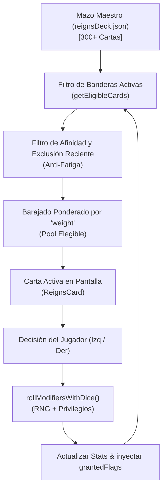

# 05. Arquitectura de Escalado del Motor (200 - 500 Cartas)

> *«Un mazo grande sin arquitectura genera caos; un mazo grande con grafos de banderas genera una experiencia rolera viva donde cada partida cuenta una legislatura irrepetible.»*

---

## 1. Cómo procesa el Motor el Grafo de Cartas

El motor de juego en [gameStore.ts](file:///f:/Abi/Proyecto/Fanzine/src/store/gameStore.ts) utiliza una arquitectura reactiva en cliente respaldada por Zustand y TypeScript.



### Ciclo de Vida de una Carta:
1. **Inicio de Partida:** `activeFlags` está vacío `{}`. El motor extrae todas las cartas que tienen `requiredFlags: []` (el mazo base de apertura, ~50 cartas).
2. **Activación de Banderas:** Cuando el jugador toma una decisión que contiene `grantedFlags: ["soborno_castor"]`, esa clave pasa a ser `true` en el store.
3. **Desbloqueo de Sagas:** En el siguiente turno, el filtro `getEligibleCards()` evalúa todo el mazo:
   - Cualquier carta que requiera `["soborno_castor"]` entra inmediatamente en el bombo de elegibles.
   - Las cartas cuyas condiciones ya no se cumplen dejan de salir.

---

## 2. Solución a la Repetición: Mecanismo de Descarte y Enfriamiento (Cooldown)

Cuando el mazo crece a más de 100 cartas, el motor incorpora una pila de enfriamiento (*cooldown buffer*):
- Una carta que ya ha aparecido entra en una lista de descarte durante al menos **12 trimestres** (3 años de juego ficticio) antes de poder volver a salir, a menos que sea una carta de crisis activada por un nivel extremo.
- Las cartas con `weight: 1` funcionan como eventos únicos de clímax: una vez resueltas, no vuelven a aparecer en esa legislatura.

---

## 3. Compatibilidad con el Sistema de Dados y Privilegios

Todas las cartas nuevas que se importen desde AI Studio interactúan de forma nativa con el sistema implementado:
1. **Los Modificadores son la Base:** Los números de `modifiers` en el JSON se consideran el centro de la horquilla.
2. **Cálculo Automático de Variación:** El motor calcula automáticamente el dado (`1d4`, `1d6` o `1d8`) según la magnitud del impacto sin que AI Studio tenga que calcular los dados a mano.
3. **Los Privilegios Actúan Solos:** Si la carta sube `presionJudicial: 12`, y el jugador tiene el privilegio `10` (*Borrado con Martillo a Discos*), el motor resta automáticamente `-4%` a la tirada sin requerir lógica especial en la carta.
4. **Desbloqueo de Nuevos Privilegios:** Si una decisión incluye `"mechanicId": 23`, el motor suma automáticamente ese privilegio al dossier del jugador para el resto de su mandato.

---

## 4. Opciones de Ingesta al Proyecto

Tienes dos caminos para incorporar los bloques generados por AI Studio:

### Opción A: Ingesta Automática mediante Script (Recomendada para lotes grandes)
Puedes ejecutar el validador con la bandera `--merge`:
```powershell
node "Plan AI Studio/validate_ai_studio_output.mjs" nuevas_cartas.json --merge
```
El script validará el esquema Zod, comprobará que no haya IDs duplicados y añadirá las nuevas cartas directamente a [src/content/reignsDeck.json](file:///f:/Abi/Proyecto/Fanzine/src/content/reignsDeck.json).

### Opción B: Ingesta Visual mediante el Panel `/admin`
1. Abre tu navegador en `http://localhost:3000/admin`.
2. Introduce la clave de acceso judicial (`palante2026`).
3. Ve a la pestaña **Redacción / Crear Carta** y pega el JSON de la carta.
4. El panel validará visualmente los campos y la añadirá al catálogo en caliente.
