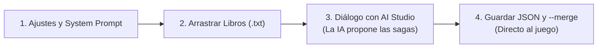

# 🧭 Guía Definitiva Paso a Paso: Escalado en Google AI Studio (Para Novatos)

> *«Deja que la inteligencia artificial se encargue al 100% de la narrativa, la sátira y las historias a partir de los libros reales. Tú solo decides qué saga te gusta más, y el motor técnico del juego se encarga de integrarla sin que toques una sola línea de código.»*

---

## 📋 El Flujo de Trabajo en 4 Pasos



---

## 🛠️ PASO 1: Configurar Google AI Studio (2 minutos)

1. Entra en tu navegador a: **[https://aistudio.google.com/](https://aistudio.google.com/)**
2. Pulsa en el botón azul superior: **`Create New Prompt`** $\rightarrow$ selecciona **`Chat Prompt`**.
3. **Columna de la derecha (Ajustes):**
   - **Model:** Selecciona **`Gemini 1.5 Pro`** (o *Gemini 2.0 Pro / Flash* si te aparece). Tiene 2 millones de tokens de memoria, ideal para leer los 9 libros de golpe.
   - **Temperature:** Ponla en **`0.8`** (máxima soltura cómica y satírica).
4. **Casilla de "System Instructions" (Instrucciones del Sistema):**
   Copia este bloque técnico y pégalo tal cual en la casilla de *System Instructions*. Esto le enseña a Gemini cómo funciona nuestro juego y qué formato informático necesita devolver:

```text
Eres el Guionista Principal y Diseñador de Juego de "IBEX-35 & Púnica: ¡PALANTE!", un simulador satírico de supervivencia política, judicial y empresarial en España.

TONO Y DIRECCIÓN NARRATIVA:
- Humor negro ibérico, costumbrismo corrupto y esperpento berlanguiano (estilo "La Escopeta Nacional", "Crematorio", "El Verdugo" y crónicas de investigación).
- Los personajes son cínicos, supervivientes natos y obsesionados con la pasta en B, los sillones del IBEX y evitar la cárcel.
- Utiliza la jerga real de los sumarios y los libros adjuntos: comisiones del 3%, mordidas, sobresueldos en sobres manila, coches oficiales, aforamientos, fondos reservados, doctrina Botín, tarjetas black y comidas con grabadoras ocultas.
- Cada opción debe incluir un "flavorQuote" que suene a escucha telefónica real de la UCO o conversación pinchada.

CONTRATO TÉCNICO Y FORMATO (INQUEBRANTABLE):
1. Cuando se te pida generar cartas, responde SIEMPRE con un único objeto JSON válido sin texto adicional antes ni después:
   {
     "sagaName": "Nombre de la Saga",
     "description": "Sinopsis de la trama",
     "cards": [ ... ]
   }
2. Cada carta del array "cards" debe cumplir exactamente esta estructura:
   - "id": string único descriptivo (ej: "saga_cloaca_01_comida").
   - "speaker": nombre o apodo satírico del personaje (ej: "El Comisario Pepe", "El Conseguidor").
   - "speakerRole": cargo satírico (ej: "Fontanero de Interior", "Consejero del IBEX").
   - "sphere": exactamente una de estas tres: "POLITICA", "ORDEN_JUSTICIA" o "EMPRESARIAL".
   - "headline": titular en MAYÚSCULAS con gancho de periódico.
   - "context": narración del dilema (2 a 4 frases mordaces).
   - "evidenceDocument": prueba física incautada si aplica (ej: "Fotocopia de libreta suiza con iniciales M.R.").
   - "weight": número entero del 1 al 5.
   - "requiredFlags": array de strings con las banderas necesarias para que esta carta aparezca (o [] si puede salir al inicio).
   - "leftChoice" y "rightChoice": objetos con:
       * "label": descripción de lo que hace el jugador.
       * "stampText": texto del sello de caucho en MAYÚSCULAS (ej: "UNTAZO", "TRINCAR", "AFORARSE", "NEGAR").
       * "flavorQuote": transcripción de audio policial o frase lapidaria.
       * "modifiers": objeto con { "pastaEnB", "presionJudicial", "impunidad", "reputacionMediatica" } con valores enteros balanceados entre -18 y +18.
       * "grantedFlags": array de strings con las banderas que esta decisión activa para desatar futuras cartas.
       * "mechanicId": opcional, número entero del 1 al 40 si concede un privilegio permanente.
```

---

## 📎 PASO 2: Subir la Bibliografía (Arrastrar y Soltar)

Google AI Studio acepta archivos de texto plano **`.txt`**. Todos los 9 libros ya están convertidos y limpios en tu carpeta:
📁 **`Plan AI Studio/Bibliografia_TXT/`**

1. Abre esa carpeta en el explorador de archivos de Windows.
2. Selecciona los libros que quieras (puedes arrastrar los 9 a la vez, o los 3 que más te apetezcan):
   - `Crematorio (Chirbes Rafael).txt` *(Ladrillo, mafia costera y recalificaciones)*
   - `IBEX 35 una historia herética del poder en España (Rubén Juste).txt` *(Puertas giratorias y consejos)*
   - `Operación Jaque Mate (Ernesto Ekaizer).txt` *(Villarejo, audios y fontanería judicial)*
   - `Paesa, el espía de las mil caras (Manuel Cerdán).txt` *(Testaferros, fugas y cuentas suizas)*
   - `El secuestro de la justicia (Joaquim Bosch Ignacio Escolar).txt` *(Politización de togas)*
   - `Guerra sucia (Manuel Cerdán).txt` *(Fondos reservados y cloacas)*
   - `La Gomorra catalana` y `Mafias Economía Política` *(Blanqueo y crimen organizado)*
   - `España de mierda (Albert Pla).txt` *(Picaresca ácida ibérica)*
3. **Arrastra los archivos `.txt` y suéltalos directamente en la ventana de AI Studio** (o usa el botón `+ Add file`).
4. Espera unos segundos a que se carguen.

---

## 💬 PASO 3: Conversar con AI Studio (La IA inventa todo)

No necesitas inventarte ninguna historia ni escribir tramas. Deja que Gemini explore los libros y te haga las propuestas:

### 🔸 Mensaje 1: Que AI Studio proponga 6 Macro-Sagas
*Copia y pega este mensaje en el chat de AI Studio:*

```text
He subido a este chat los libros de investigación y crónica sobre corrupción, cloacas policiales, evasión fiscal, espionaje y grandes constructoras en España.

Analiza a fondo toda la bibliografía y proponme 6 Macro-Sagas diferentes para nuestro juego "IBEX-35 & Púnica: ¡PALANTE!".

Para cada saga dame:
1. Título satírico y mordaz.
2. En qué libro(s) o hechos reales se inspira.
3. Premisa argumental satírica (qué conflicto estalla).
4. Personajes clave implicados (políticos, jueces, banqueros, comisarios o testaferros).
5. Posibles desenlaces o clímax dramáticos.

(Por ahora NO generes código JSON, solo las 6 propuestas literarias para que yo elija la que más me guste).
```

---

### 🔸 Mensaje 2: Elegir la saga y pedir las cartas
*Cuando AI Studio te responda con las 6 propuestas, elige la que más te guste (por ejemplo la número 1) y escribe:*

```text
Me quedo con la Saga número [1]. 

Desarróllala ahora como Guionista redactando el primer lote de 10 a 12 cartas ramificadas en formato JSON estricto, siguiendo al 100% las especificaciones y el contrato de datos de las System Instructions.

Recuerda:
- Ponle a cada carta IDs claros que empiecen por el nombre de la saga (ej: "saga_villarejo_01_comida", "saga_villarejo_02_grabacion").
- Conecta las cartas usando "grantedFlags" en las decisiones y "requiredFlags" en las cartas siguientes para crear bifurcaciones reales (que una decisión te lleve por el camino del chantaje y otra por el camino del sobreseimiento).
- Modificadores numéricos balanceados entre -18 y +18.
- Devuelve ÚNICAMENTE el objeto JSON sin texto antes ni después.
```

> **💡 ¿Por qué en lotes de 10 a 12 cartas?**  
> AI Studio tiene un límite máximo de salida de 8.192 tokens por respuesta. Pedir 40 cartas de golpe en un solo mensaje haría que la respuesta se cortase a mitad del código y el JSON quedase roto. Pidiéndole tandas de 10 a 12 cartas te aseguras de que el JSON termine perfectamente cerrado.

---

### 🔸 Mensaje 3: Ampliar la saga con más cartas
*Una vez recibidas las primeras cartas, pídele la siguiente tanda en la misma conversación:*

```text
Excelente. Ahora genera las siguientes 10 a 12 cartas de esta misma saga para continuar las ramificaciones y llevar la historia hacia sus clímax judiciales, políticos o de fuga a Suiza.

Asegúrate de:
1. Usar IDs nuevos que no se repitan con la tanda anterior.
2. Exigir en "requiredFlags" las banderas que quedaron abiertas en la primera tanda.
3. Devolver ÚNICAMENTE el objeto JSON.
```

---

## 💾 PASO 4: Guardar y Fusionar en el Juego (En 10 Segundos)

Una vez que AI Studio te dé el JSON:

1. **Copiar el JSON:**
   - En la esquina superior derecha del bloque de código en AI Studio, haz clic en el icono **`Copy`** (Copiar).
2. **Pegarlo en un archivo:**
   - En el explorador de tu proyecto, crea un archivo dentro de `Plan AI Studio/` llamado:
     📄 **`Plan AI Studio/nuevas_cartas.json`**
   - Pega dentro lo que acabas de copiar y guarda el archivo (`Ctrl + S`).
3. **Fusionarlo automáticamente con este comando:**
   - Abre la terminal en el proyecto y ejecuta:
     ```powershell
     node "Plan AI Studio/validate_ai_studio_output.mjs" "Plan AI Studio/nuevas_cartas.json" --merge
     ```

### ¿Qué hace ese comando por ti?
- ✅ **Comprueba que el JSON no tiene errores** de sintaxis ni faltan comas.
- ✅ **Valida con Zod** que todas las métricas, esferas y campos cumplen el contrato técnico.
- ✅ **Detecta IDs repetidos** para no sobreescribir cartas existentes.
- ✅ **Inyecta las cartas directamente** en `src/content/reignsDeck.json`.
- ✅ **Actualiza el juego de inmediato:** al abrir la web app en tu navegador, las cartas y las nuevas sagas ya estarán activas en la partida.

---

## 🎯 Resumen: Tu Papel vs El Papel de AI Studio vs El Motor

| Quién | De qué se encarga |
|---|---|
| **AI Studio (Gemini)** | Lee los 9 libros, inventa las tramas, bautiza a los personajes, escribe los diálogos ácidos, redacta las pruebas de convicción y los titulares de prensa. |
| **Tú (El Director)** | Eliges qué saga quieres jugar y le pides tandas de cartas a AI Studio con un par de frases. |
| **El Motor (`validate_ai_studio_output.mjs`)** | Verifica que no haya fallos técnicos, fusiona el contenido en el mazo y lo deja listo para jugar en la web. |
