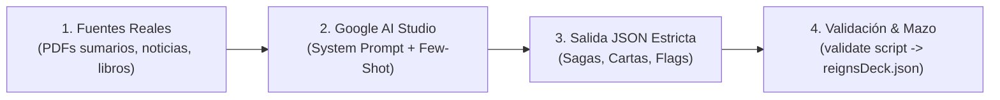

# Kit de Escalado Masivo: IBEX-35 & Púnica: ¡PALANTE!
## Guía y Especificaciones de Retorno para Google AI Studio

> *«De una baraja de bolsillo de 40 cartas a una enciclopedia viva de la cleptocracia española con más de 300 dilemas, sagas ramificadas, escuchas telefónicas reales y consecuencias impredecibles.»*

---

## 🎯 Objetivo de este Kit

Este directorio contiene todo el material técnico, conceptual y de ingeniería de prompts necesario para que puedas utilizar **Google AI Studio** (aprovechando su ventana de contexto masiva de 1 a 2 millones de tokens) alimentándolo con libros, sumarios judiciales, noticias de hemeroteca y audios de escuchas, y obtener de vuelta **bloques masivos de contenido narrativo perfectamente estructurados y tipados** que se integran en el juego sin romper código ni provocar repetición.

---

## 📂 Contenido del Kit

| Archivo | Propósito | Cuándo usarlo |
|---|---|---|
| **[01_GUIA_ORQUESTADOR_AI_STUDIO.md](file:///f:/Abi/Proyecto/Fanzine/Plan%20AI%20Studio/01_GUIA_ORQUESTADOR_AI_STUDIO.md)** | Manual operativo para configurar AI Studio: modelos, temperatura, fuentes recomendadas y flujo de trabajo. | Antes de arrancar cualquier sesión en AI Studio. |
| **[02_CONTRATOS_Y_ESQUEMAS_JSON.md](file:///f:/Abi/Proyecto/Fanzine/Plan%20AI%20Studio/02_CONTRATOS_Y_ESQUEMAS_JSON.md)** | Especificación formal de los esquemas Zod/TypeScript. Qué campos, rangos, enums y tipos requiere estrictamente el motor. | Referencia técnica para configurar el *Structured Output* (JSON) en AI Studio. |
| **[03_SYSTEM_PROMPTS_Y_PLANTILLAS_AI_STUDIO.md](file:///f:/Abi/Proyecto/Fanzine/Plan%20AI%20Studio/03_SYSTEM_PROMPTS_Y_PLANTILLAS_AI_STUDIO.md)** | Prompts listos para copiar y pegar: System Instructions de tono berlanguiano y plantillas para macro-sagas, cartas virales y personajes. | En la caja de "System Instructions" y en cada prompt de generación. |
| **[04_EJEMPLOS_FEW_SHOT_DE_ORO.md](file:///f:/Abi/Proyecto/Fanzine/Plan%20AI%20Studio/04_EJEMPLOS_FEW_SHOT_DE_ORO.md)** | Ejemplos canónicos reales del mazo maestro en JSON puro para que la IA entienda el estándar de oro de humor, diálogos y flags. | Para adjuntar como ejemplos *Few-Shot* en el prompt. |
| **[05_ARQUITECTURA_DE_ESCALADO_DEL_MOTOR.md](file:///f:/Abi/Proyecto/Fanzine/Plan%20AI%20Studio/05_ARQUITECTURA_DE_ESCALADO_DEL_MOTOR.md)** | Explicación de cómo el motor baraja 300+ cartas, resuelve dependencias de banderas (`flags`) y evita la fatiga del jugador. | Para entender cómo encaja la narrativa en la lógica de Zustand. |
| **[validate_ai_studio_output.mjs](file:///f:/Abi/Proyecto/Fanzine/Plan%20AI%20Studio/validate_ai_studio_output.mjs)** | Script en Node.js que valida cualquier JSON generado por AI Studio antes de incorporarlo al juego. | Al recibir la respuesta de AI Studio: `node "Plan AI Studio/validate_ai_studio_output.mjs" archivo.json`. |

---

## ⚡ Flujo de Trabajo en 4 Pasos

1. **Alimenta AI Studio** con documentos reales (sumarios, reportajes, biografías).
2. **Aplica el System Prompt Maestro** de `03_SYSTEM_PROMPTS_Y_PLANTILLAS_AI_STUDIO.md`.
3. **Pide el retorno en JSON** según `02_CONTRATOS_Y_ESQUEMAS_JSON.md`.
4. **Valida el archivo** con `node "Plan AI Studio/validate_ai_studio_output.mjs" salida.json` y añádelo al juego directamente desde `/admin` o fusionándolo con `reignsDeck.json`.
